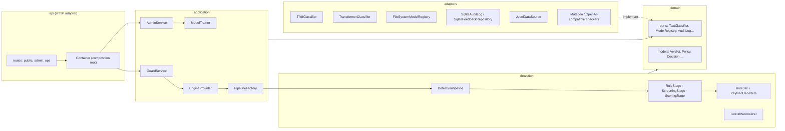

# Architecture

Kalkan follows a layered (hexagonal / ports-and-adapters) design. Dependencies point inward: the domain knows nothing about FastAPI, scikit-learn or SQLite.

## Layers

| Layer | Package | Depends on | Responsibility |
| --- | --- | --- | --- |
| Domain | `kalkan/domain` | nothing | Entities and value objects (`Verdict`, `Policy`, `Decision`, `Source`) and ports (interfaces) |
| Detection | `kalkan/detection` | domain | Turkish normaliser, rules, evasion transforms, stages, pipeline |
| Application | `kalkan/application` | domain, detection, ports | Use cases: check, report, review, retrain, activate; pipeline factory; policy resolution |
| Adapters | `kalkan/adapters` | domain | Concrete classifiers, registry, storage, data source, attack generators |
| API | `kalkan/api` | all of the above | FastAPI routes, auth, schemas, composition root, UI |
| Client | `clients/python` | httpx only | SDK for consuming chatbots |

## SOLID in practice

- **Single responsibility:** each class does one job: `RuleSet` matches, `RuleStage` turns a match into a stage result, `SqliteAuditLog` and `SqliteFeedbackRepository` are separate even though they share one database.
- **Open/closed:** add a rule with `RuleSet.register()`, a decoder by implementing `PayloadDecoder`, a model by implementing `TextClassifier` and adding it in `PipelineFactory`; the pipeline and services do not change.
- **Liskov substitution:** any `TextClassifier` works in `ScreeningStage` / `ScoringStage`; tests run the pipeline with a fake classifier.
- **Interface segregation:** small ports (`AuditLog`, `FeedbackRepository`, `ModelRegistry`, `TrainingDataSource`, `AttackGenerator`) instead of one storage interface.
- **Dependency inversion:** services receive ports through their constructors; only `api/container.py` and `application/factory.py` name concrete classes.

## Patterns

| Pattern | Where | Why |
| --- | --- | --- |
| Ports and adapters | `domain/ports.py`, `adapters/` | Swap SQLite for Postgres, scikit-learn for ONNX, or one LLM provider for another without touching use cases |
| Chain of responsibility | `detection/pipeline.py`, `detection/stages.py` | Cheap stages decide obvious cases; only uncertain input reaches heavier models |
| Strategy | `domain/models.Policy`, `application/policies.ClientPolicies` | Per-client thresholds without branching in the engine |
| Factory | `application/factory.PipelineFactory` | One place decides which stages exist for a model version |
| Facade | `kalkan.Kalkan` (in-process), `GuardService` / `AdminService` (for the API) | One simple entry point over registry, factory and pipeline |
| Adapter | `TfidfClassifier`, `TransformerClassifier`, `OpenAICompatibleAttacker`, SQLite classes | Wrap third-party libraries behind domain ports |
| Repository | `SqliteFeedbackRepository`, `FileSystemModelRegistry` | Persistence behind collection-like interfaces |
| Composition root / DI | `api/container.py` | All wiring in one place; tests build the app with their own settings |

## Request flow (`POST /v1/check`)

1. `ApiKeyAuthenticator` resolves the client name from the key.
2. `GuardService.check` enforces size limits and resolves the client's `Policy`.
3. `EngineProvider.current` returns the live `DetectionPipeline` (swapped atomically on activation).
4. The pipeline normalises the text, runs `RuleStage` → `ScreeningStage` → optional `ScoringStage`, stops at the first decision, otherwise asks the policy.
5. The verdict is written to the `AuditLog` (hash always, text per retention setting) and returned with a `request_id`.

## Extension points

| To add | Implement | Register in |
| --- | --- | --- |
| A rule | `Rule` (`name`, `matches(folded)`) | `detection/rules.default_rules()` or `RuleSet.register()` |
| An encoded-payload decoder | `PayloadDecoder` | `RuleSet(decoders=…)` |
| A model | `TextClassifier` (+ `fit/save` if trainable) | `PipelineFactory.build()` |
| A storage backend | `AuditLog`, `FeedbackRepository` | `api/container.py` |
| An attack generator | `AttackGenerator` | `scripts/redteam.py` |
